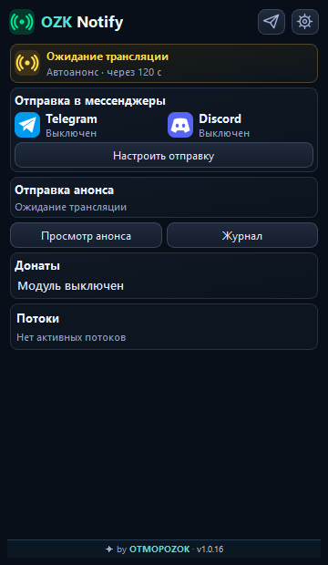
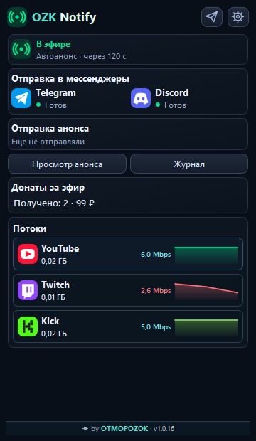
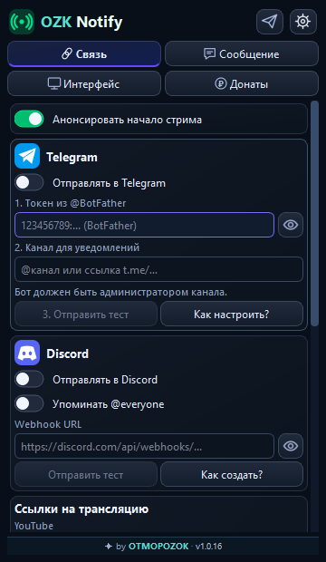
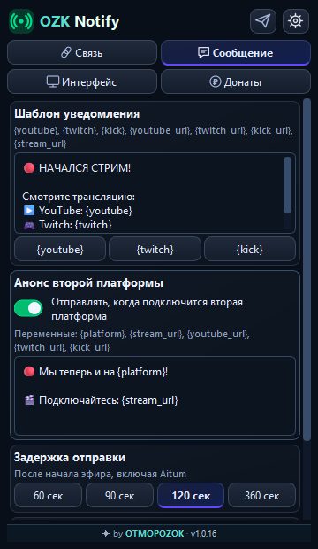
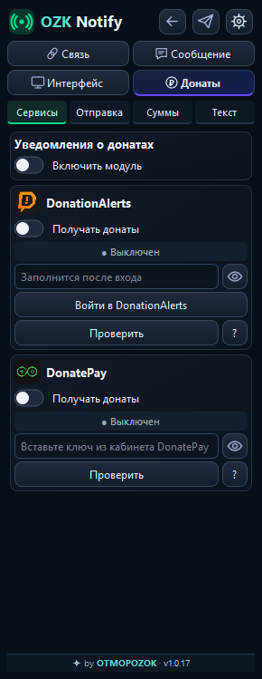
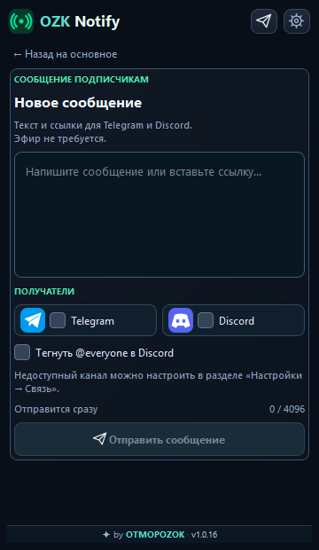

# OZK Notify for OBS

**Версия 1.0.22:** временные сбои DonatePay автоматически перепроверяются с паузой; состояние показывает, что идёт повторное подключение. Ошибка ключа также проверяется раз в 5 минут. В паре с OZK Donations новые события по-прежнему опрашивает один плагин.

**Версия 1.0.20:** Notify передаёт OZK Donations данные DonatePay и сообщает, что следит за новыми донатами. При совместной работе Donations не делает такой же регулярный запрос. Каждый плагин сохраняет самостоятельное подключение, если второй не установлен или выключен.

Версия 1.0.19: полученные донаты DonatePay передаются в OZK Donations 0.6.2 и новее внутри OBS — имя, сумма и сообщение появляются без повторного сетевого запроса. Уведомления в Telegram и Discord сохраняют защиту от повторной отправки. Каждый плагин работает и отдельно.

Часть набора **OZK StreamKit** от OTMOPOZOK. Работает и отдельно от остальных плагинов.

**Первая стабильная версия до переименования: 1.0.14.** Она была проверена в OBS автором проекта.

**Сборка 1.0.19 для проверки:** в настройках появилась кнопка «Назад» слева от кнопки отправки сообщения. Она совпадает с соседними кнопками по размеру и возвращает на главную панель. Снимки ниже сделаны в тестовом интерфейсе.

**OZK Notify — плагин уведомлений для OBS Studio:** отправляет анонсы трансляций Twitch, YouTube и Kick в Telegram и Discord, показывает состояние эфира и сообщения о донатах.

## Как выглядит

Снимки сделаны в тестовом интерфейсе. Поля входа пустые, реальные ключи и личные данные не показаны.

| Ожидание эфира | Во время трансляции |
| --- | --- |
|  |  |
| Настройки связи с кнопкой «Назад» | Настройки текста анонса |
|  |  |
| Настройки донатов | Ручное сообщение |
|  |  |

[Узкая панель](docs/screenshots/home-narrow.png) · [English](docs/README_EN.md)

## Что удобно

- Плагин распознаёт потоки Twitch, YouTube и Kick, показывает каждый отдельно и считает его битрейт и объём передачи.
- Для Twitch, YouTube и Kick плагин добавляет ссылки на подтверждённые трансляции. Для Kick можно также указать ссылку вручную.
- Если вторая или третья платформа запустилась позже, можно отправить отдельное короткое сообщение.
- Текст анонсов, задержку и получателей можно менять в самой панели OBS.
- Уведомления о донатах DonationAlerts и DonatePay настраиваются отдельно.
- [OZK Donations](https://github.com/DIMI0007/ozk-donations) показывает донаты этих сервисов в отдельной панели OBS и может использовать сохранённый здесь вход для новых донатов. Лента открывается из кеша сразу, а общие суммы и суммы за месяц рассчитываются постепенно по всей доступной истории. Для истории DonationAlerts потребуется один раз разрешить чтение прошлых донатов в Donations.
- OZK Stats показывает CPU, учтённые данные и трафик Notify за время работы OBS.
- В журнале видны время, получатель и результат последних отправок. Для новых неудачных отправок сохраняется причина ошибки.
- «Просмотр анонса» показывает готовый текст со свежими подтверждёнными ссылками. Его можно открыть для ручной отправки и проверить перед нажатием кнопки отправки.

## Как плагины работают вместе

OZK Notify работает самостоятельно: подключите здесь нужные аккаунты и получателей. Если установлен OZK Chat, Notify может использовать его защищённые данные Twitch и YouTube, а также имя канала Kick, только для проверки эфира. Stats, если установлен, считывает локальные показатели Notify; он не участвует в отправке анонсов. OZK Donations, если установлен, читает сохранённый доступ к DonationAlerts и DonatePay для отдельного списка донатов; настройки Notify он не меняет. Доступ к прошлым донатам DonationAlerts разрешается отдельно. Без Notify эту панель тоже можно подключить самостоятельно.

## Как установить

1. Полностью закройте OBS. Скачайте **OZKNotify-1.0.22-OBS33-Windows-x64** на странице [сборки Windows](https://github.com/DIMI0007/ozk-notify/actions/workflows/build-only-windows.yml) и распакуйте ZIP.
2. Откройте `C:\ProgramData\obs-studio\plugins\`. Удалите старую папку `stream-notify`, если она есть. Скопируйте сюда папку `stream-notify` из ZIP целиком.
3. Запустите OBS. Откройте **Док-панели → OZK Notify**, подключите Telegram или Discord и нажмите **«Отправить тест»**. Для тестового сообщения эфир не нужен.

Файл `stream-notify.dll` должен лежать прямо в папке `stream-notify`, рядом с `Qt6WebSockets.dll` и папкой `data`. Настройки хранятся отдельно. [Подробная инструкция](docs/TEST_WINDOWS_RU.md).

Название папки и DLL оставлено прежним, чтобы сохранить настройки и расположение панели OBS. В самой OBS плагин называется **OZK Notify**.

В шаблонах доступны `{twitch}`, `{youtube}`, `{kick}` и `{stream_url}`. Старый стандартный шаблон обновляется автоматически; пользовательский текст сохраняется без изменений.

Для **OBS Studio 33 на Windows x64**. Сборка пока не подписана. Автоматические ссылки и защита от повторных анонсов дополнительно проверяются во время реального мультистрима.

## Ещё

[Как работают анонсы](docs/AUTO_ANNOUNCEMENTS_RU.md) · [Донаты](README_DONATIONS_RU.md) · [Общий стиль](docs/VISUAL_STYLE_RU.md) · [Конфиденциальность](PRIVACY.md) · [Лицензия](LICENSE)

Разработчик: [OTMOPOZOK](https://www.youtube.com/channel/UCTAKYR3T2Ud8zZgNShgQfyw/).

## Поддержать проект

Если плагины полезны вам, поддержите проект донатом. Ваша помощь поддерживает развитие плагинов, исправления и будущую разработку.

[Поддержать через DonationAlerts](https://www.donationalerts.com/r/otmopozok) · [Поддержать через DonatePay](https://donatepay.ru/don/OTMOPOZOK)
